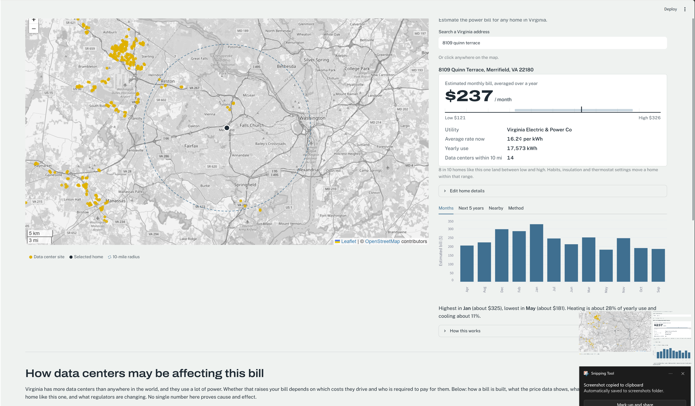

# Wattson: Power Bills in Data Center Country

[](https://github.com/shreya-1508/wattson/actions/workflows/ci.yml)



Search any Virginia address, or click a spot on the map, to see an estimated monthly electricity bill for a home like yours,
how it could change over the next five years, and the data centers around you. Behind it is a
grid-level forecaster for Northern Virginia, the world's largest data center market.

> Educational estimates from public data, not a utility quote. Python · scikit-learn · Streamlit · Folium

## What it does

| Page | What you see | How it works |
|---|---|---|
| **Map** | Address search and click-to-estimate on a map of Virginia's data center sites; monthly bill as a likely range (low / typical / high), month-by-month costs, a 5-year cost outlook, data centers within 10 miles | ML model trained on EIA's survey of ~18,500 U.S. homes, local weather, your utility's rate |
| **Data centers & your bill** (below the map) | How each part of a bill can be affected; Virginia vs. U.S. price growth translated into this home's bill; published estimates (market monitor, JLARC, Dominion) scaled to this home's usage; policy changes | EIA state and national price history, sourced studies, the grid page's overnight-load signal |
| **Grid Forecast** | Day-ahead hourly demand forecast for Dominion's zone vs. baselines; growth in 24/7 overnight load | Gradient-boosted forecaster on EIA hourly grid data, walk-forward backtested |

## Results

**Home usage model** (held-out homes the model never saw)

| Metric | Value |
|---|---|
| Typical error (median absolute % error) | 26.8% |
| Simple per-square-foot baseline | 42.9% (model: 37% less error) |
| Actual use inside the low-high range | 79% (target 80%) |

**Grid forecaster** (Dominion zone, 12-month walk-forward backtest)

| Metric | Model | Best baseline |
|---|---|---|
| Hourly error (MAPE) | 4.17% | 6.18% (same hour yesterday) |
| Daily peak error | 4.50% | 6.88% |
| Overnight baseload growth | 7.3% / year (+42% since 2021) | |

## Design decisions worth knowing

- **Ranges, not false precision.** No public data shows a specific home's usage, so the app estimates
  from home facts, like Zillow does for prices, and shows a range. Quantile models fit on training data
  give ranges that are too narrow, so the ranges are widened with **split-conformal calibration** on
  held-out homes until 80% of unseen homes fall inside.
- **Trained nationally, applied locally.** The model learns from homes across the U.S. using heating and
  cooling degree days, then uses five years of weather at *your* address.
- **Evidence kept separate from estimates.** The data center section shows what's *measured* (Virginia vs. U.S. prices,
  which filters out national factors like inflation) apart from what studies *estimate*, and never adds figures
  that measure different things. Correlation is labeled as correlation.
- **Scenarios, not predictions.** Future costs extend Virginia's own price history. Prices actually move
  with rate cases and policy, such as Virginia's new rate class for large data centers starting in 2027.
- **Growth-proof grid model.** Tree models can't predict above anything they've seen, but data center
  load keeps setting records. The forecaster predicts demand relative to last week's average instead.
- **No leakage.** A test proves the grid forecaster never sees demand from inside the forecast window.

## Run it

```bash
python -m venv .venv && source .venv/bin/activate   # Windows: .venv\Scripts\Activate.ps1
pip install -e ".[app,dev]"
cp .env.example .env                 # add your free EIA key (eia.gov/opendata)

python -m gridcast setup-home        # one time: downloads public data, trains the home model
python -m gridcast fetch --area DOM --start 2021-01-01
python -m gridcast backtest --area DOM

streamlit run app/Home.py           # Wattson
pytest -q
```

## Data sources (all free and public)

| Data | Source |
|---|---|
| Home energy use + home details | EIA Residential Energy Consumption Survey 2020 |
| Hourly grid demand, operator forecast, VA and U.S. price history | EIA Open Data API |
| Data center cost estimates | PJM Independent Market Monitor, JLARC, Dominion, Virginia SCC (linked in the app) |
| Utility rates by ZIP | NREL / OpenEI (2024) |
| Address search + map clicks | U.S. Census geocoder; OpenStreetMap Nominatim for partial searches |
| Map tiles | OpenStreetMap |
| Weather | Open-Meteo historical archive |
| Data center locations | OpenStreetMap contributors (incomplete coverage) |

## Limitations

- Bills are estimates for a *typical* home with the facts you enter. Insulation, habits and thermostat
  settings move a real home within (and sometimes outside) the range.
- Utility rates are 2024 averages scaled by the statewide trend, and include fixed charges.
- Being near a data center doesn't change your rate by itself: rates are set utility-wide.
- The grid backtest uses observed temperature, so live forecasting error would be somewhat higher.

## Roadmap

- [ ] Deploy on AWS (nightly data refresh with Lambda, app on App Runner)
- [ ] Rate-plan detail (time-of-use, tiers) from the OpenEI Utility Rate Database
- [ ] Expand beyond Virginia
- [ ] LLM-written plain-English summary of each estimate
